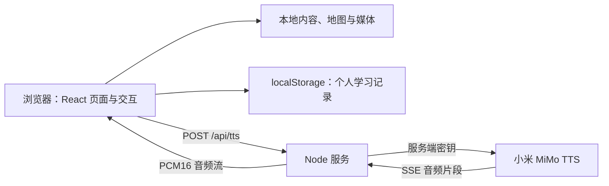

# 重走长征路

当前发布版本：**V1.06**。更新说明见 [1.06 版本记录](docs/releases/1.06.md)。

**循着先辈的足迹，走进山河深处。在每一次选择与跋涉中，读懂长征。**

“重走长征路”是交付事业部纪念长征胜利 90 周年专栏，也是一个以地图、全景、故事和声音串联历史内容的互动学习网站。读者可以沿着二十二个历史节点走进长征，也可以从一则故事、一首诗词或一支队伍的行程开始阅读。

项目采用 React、TypeScript 和 Vite 构建，配套轻量 Node.js 服务。正文、地图、图片、字体和背景音乐随项目部署；学习记录保存在浏览器本地，无需注册账号或部署数据库。在线语音合成由服务端连接小米 MiMo TTS，密钥不进入浏览器。

## 项目内容

全站由 **首页、六个内容专题和学习中心** 组成，共八个模块。首页以六个圆形标题节点连接专题，学习中心与行囊合并为顶部入口。

| 模块     | 内容与体验                                                    | 路由         |
| -------- | ------------------------------------------------------------- | ------------ |
| 首页     | 六主题路线总览、背景音乐、页面讲解与静观山河                  | `#/home`     |
| 历史序幕 | 根据地处境、反“围剿”背景、出发前夕与整理行囊                  | `#/prologue` |
| 万里征途 | 地理路线图、22 个历史节点、22 幅独立全景、分段叙事与完整史料  | `#/journey`  |
| 四路红军 | 红一、红二、红四方面军与红二十五军的行程、特点和对照阅读      | `#/armies`   |
| 篝火夜话 | 20 则故事、20 件物件插画与各篇教育微点拨                      | `#/stories`  |
| 长征回响 | “赓续长征”纪念专题、长征的历史意义与个人回望                  | `#/meaning`  |
| 诗意长征 | 六组诗词的原文、背景、解读，以及遮句背诵和填句练习            | `#/poetry`   |
| 学习中心 | 足迹、收藏、8 枚学习勋章、15 道测验、情境任务、手记和记录备份 | `#/learn`    |

诗词包括《七律·长征》《忆秦娥·娄山关》《清平乐·六盘山》《十六字令三首》《念奴娇·昆仑》《六言诗·给彭德怀同志》；其中《十六字令三首》作为一组呈现。

## 主要特色

### 从地图进入内容

首页与各专题以路线节点组织阅读。鼠标悬停或键盘聚焦时展示介绍，点击节点直接进入主题或打开对应详情，减少重复确认。首页电脑端为横向六节点，手机端为两列三行，四字标题直接显示在节点内。

“万里征途”使用独立的地理地图：

- 22 个节点依据地点的近似经纬度定位；数字标签避让时，以引线保留真实地理锚点。
- 四支部队路线可分别显示或隐藏，“关键节点”开关独立控制 22 个节点。
- 隐藏关键节点后显示沿途地名。电脑端保留完整地名集，手机端按所选路线精简为 3—4 个关键地名。
- 支持放大、缩小和上下左右拖动。电脑端右侧、手机端下方的图文预览也可直接点击进入当前站点。
- 中央红军主路线结束于 1935 年的吴起镇；1936 年三大主力会师单独表达，不将两者画成直接连续的行军线。

“四路红军”分别呈现四支队伍的独立行进地图、五阶段过程与总结，并增加“四路对照”，从时间、路线和贡献比较各支队伍。详细地图复用万里征途的地理坐标与地名数据。

地图采用本地艺术底图与矢量路线叠加，不依赖在线地图 SDK、瓦片服务或地图密钥。地理定位依据、范围与数据来源见 [地图说明](docs/maps/journey-geography.md)。

### 二十二站全景与信纸阅读

从于都夜渡到三大主力会师，每站都有独立宽幅画面、三段短叙事和可选观察点。读者可以左右环顾、隐藏文字看景、查看完整史料，也可以随时切换站点，不设解锁门槛。有对应故事或诗词的站点提供“夜话”“诗篇”入口，直接在当前场景上展开阅读。

详情统一在当前场景上以暖黄旧信纸风格弹窗展开，保留背景与阅读上下文。手机端调整内边距，并将详情表格转为卡片；关闭弹窗或按 Escape 可回到地图。搜索、收藏和直接链接也能定位到对应内容。

视觉以墨褐、旧金、朱砂为主，正文使用霞鹜臻楷，标题和地图节点使用南西油墨宋。图片与字体均从本站加载。场景拖动、路线动效和页面过渡配合阅读节奏，支持系统的减少动态效果设置。

### 音乐与流式讲解

- 本地背景音乐为《长征交响序曲》，约 7 分 17 秒，支持循环播放。
- 八个模块首页与 22 个征途页均配有讲解词；详情支持从正文开始朗读，跳过顶部标题、时间地点等信息。
- 全站共用一条语音播放通道，新讲解会停止上一段语音，但不会停止背景音乐。
- 背景音乐与讲解音量独立调节，初始值分别为 **30%** 和 **70%**，后续优先使用浏览器保存的设置。
- 音乐播放时，进入尚未听过的页面可自动讲解。自动或手动成功播放过一次后，再次进入不重复自动播放，仍可手动重听。
- 服务端使用 `mimo-v2.5-tts`，将上游 SSE 中的 PCM16 音频转为流式响应，浏览器边接收边播放。发言人和演绎提示词均可通过环境变量修改。

### 阅读之后，留下自己的足迹

学习中心集中展示阅读进度、收藏和自动获得的学习勋章。在“足迹与勋章”中可随时生成个人学习纪念证书：暖色纸张、淡山河背景与纪念章排列，记录史料阅读、故事阅读、情境体验和征途问答的足迹，只展示实际获得的勋章，支持保存高清 PNG。姓名与图片均在本机处理，无需完成测验即可生成。

知识测验提供解析与错题复习，完成页也可生成纪念证书；情境任务包括行囊取舍、夜渡、桥上协作、草地探路、电报译读等。

另保留可选的六幕互动体验，以及四渡赤水的 Remotion 动态复盘。全景浏览与完整史料阅读分别记录，浏览过画面不会自动算作读完全文。

## 快速启动

### 本地开发

需要 **Node.js 22.18 或更新版本**及 npm。首次安装依赖需要联网；安装后，网页与背景音乐由本机提供，语音合成仍需要连接小米服务。

```sh
git clone https://github.com/2guan/changzheng.git
cd changzheng
npm ci

# 可选：需要语音讲解时配置
cp .env.example .env.local
# 编辑 .env.local，填写自己的 MIMO_API_KEY

npm run dev
```

打开 **http://127.0.0.1:5173/**。

开发命令同时启动两个进程：Vite 在 `127.0.0.1:5173` 提供前端，Node 在 `127.0.0.1:4062` 提供语音接口；Vite 将 `/api` 请求代理到 Node。按 `Ctrl+C` 停止两者。5173 为固定端口，占用时启动会报错。

macOS 安装完依赖后，也可双击根目录的 `启动网站.command`。开发服务默认仅监听本机；服务器部署使用下面的生产方式。

### 本地运行生产构建

```sh
npm ci
npm run build
npm run server
```

打开 **http://127.0.0.1:4061/**。此方式由一个 Node 进程同时提供 `dist/` 静态资源与语音接口，并读取根目录的 `.env.local`。

若需监听其他设备可访问的地址：

```sh
API_HOST=0.0.0.0 API_PORT=4061 npm run server
```

`npm run preview` 只用于预览 Vite 静态构建，不提供本项目的 TTS 接口；需要完整讲解功能时使用 `npm run dev`、`npm run server` 或 Docker。

## Docker 部署

默认目标为 **Linux x86_64 / `linux/amd64`**，默认对外端口 **4061**。当前 Compose 使用镜像 `changzheng:1.06`。

### 从源码构建

在仓库根目录准备 `.env.local` 后执行：

```sh
docker buildx build --platform linux/amd64 --load -t changzheng:1.06 .
docker compose up -d --no-build --pull never
docker compose ps
curl -fsS http://127.0.0.1:4061/healthz
```

访问 `http://服务器IP:4061/`。Compose 的可选 `env_file` 写法需要 **Docker Compose 2.24 或更新版本**。Apple 芯片 Mac 也可使用上述命令构建 Linux x86_64 镜像。

### 使用已导出的镜像包

发布目录包含镜像压缩包、`compose.yaml`、`.env.local.example`、`SHA256SUMS` 和部署说明。将这些文件放在服务器同一目录，首次部署时将 `.env.local.example` 复制为 `.env.local` 并配置语音密钥；更新时保留原有 `.env.local`。

```sh
sha256sum -c SHA256SUMS
docker load -i changzheng-1.06-linux-amd64.tar.gz
docker compose up -d --no-build --pull never --force-recreate
docker compose ps
```

更新时同时使用发布包中的新版 `compose.yaml`，确保其中的镜像标签与导入的镜像一致。仓库包含构建配置，`release/` 和镜像归档不提交到 Git。

容器以非 root 用户运行，使用只读根文件系统和临时 `/tmp`，配置了健康检查、日志轮转与自动重启。无需数据库或持久化数据卷。更换服务器端口可执行 `PORT=8080 docker compose up -d --no-build --pull never`，容器内部仍监听 4061。

更多操作见 [Docker 部署说明](docs/docker-deployment.md)。

## 环境配置

配置写入项目根目录或部署目录的 **`.env.local`**。未配置密钥时，地图、阅读、学习功能和本地音乐仍可使用，语音讲解不可用。

```dotenv
MIMO_API_KEY=你的小米MiMo密钥
MIMO_TTS_VOICE=白桦
MIMO_TTS_PROMPT=
```

| 配置项            | 默认值      | 作用                                                  |
| ----------------- | ----------- | ----------------------------------------------------- |
| `MIMO_API_KEY`    | 无          | 服务端调用小米 MiMo 的密钥                            |
| `MIMO_TTS_VOICE`  | `白桦`      | 发言人，填写上游支持的 Voice ID                       |
| `MIMO_TTS_PROMPT` | 空          | 演绎提示词；留空时不发送风格指令                      |
| `SITE_PRODUCER` | `纪念长征胜利90周年专题` | 版本信息卡片第一行；留空不显示 |
| `SITE_PRODUCER_BRANCH` | 空 | 版本信息卡片第二行；留空不显示 |
| `API_HOST`        | `127.0.0.1` | Node 监听地址；Docker 内设为 `0.0.0.0`                |
| `API_PORT`        | `4061`      | Node 监听端口；开发脚本使用 `4062`                    |
| `STATIC_ROOT`     | `dist`      | Node 提供静态文件的目录                               |
| `PORT`            | `4061`      | Compose 的宿主机端口映射变量，可写入部署目录的 `.env` |

当前上游地址与模型在 `server/index.mjs`、`server/tts.mjs` 中配置，不由环境变量切换。密钥不使用 `VITE_` 前缀；`.env.local` 已被 Git 和 Docker 构建上下文排除，容器运行时由 Compose 注入。

修改发言人、提示词或版本卡片文字后，本地重启服务；Docker 执行：

```sh
docker compose up -d --no-build --pull never --force-recreate
```

单纯 `docker compose restart` 不会重新读取 `env_file`。如果前面还有反向代理，需要保留 Host 并关闭语音接口的响应缓冲，才能及时播放流式音频。

## 技术架构

项目是 **React 单页应用 + Node 静态资源与语音服务**。没有独立 CMS 或账号后端，内容作为项目数据维护并随构建发布。



| 层次       | 实现与职责                                                                                 |
| ---------- | ------------------------------------------------------------------------------------------ |
| 应用与路由 | React 19、TypeScript；自定义 Hash 路由与查询参数，支持主题、站点和阅读详情的直接链接       |
| 地图与全景 | SVG 路线和标记、本地 WebP 背景、坐标投影与标签避让、指针拖动和缩放                         |
| 动效       | Motion 负责界面动效，Remotion Player 用于四渡赤水等复盘内容                                |
| 阅读       | 共用原生 `dialog`，统一详情分发、信纸样式和正文朗读提取                                    |
| 状态       | React Context 与 localStorage；导入时校验并合并学习记录                                    |
| 声音       | 独立音乐播放器 + Web Audio 流式语音播放，全站统一取消与切换                                |
| 服务端     | Node 原生 HTTP、Fetch 与文件流；静态托管、Range 请求、缓存校验、gzip、健康检查与 TTS 转发  |
| 构建与验证 | Vite 7、TypeScript 编译检查、Node 内置测试；前端按内容库与运行库拆分产物，部分场景按需加载 |

生产模式下，网页与 `/api/tts` 同源。语音代理对文字长度、并发和请求频率作限制；浏览器取消播放时中止上游请求。它不提供用户身份认证，也不保存用户学习记录。

### 目录结构

```text
src/
  App.tsx                    应用外壳、导航、搜索与页面分发
  state.tsx / storage.ts     路由、学习状态与存档校验
  atlas.ts / atlas.css      专题地图定义与共用样式
  journeyMap.ts             长征地理坐标、路线、地名与标签布局
  journeyGeography.json     地理矢量数据
  panoramas.ts              22 站全景、叙事与手机取景位置
  armyChapters.ts           四支队伍独立篇章与共享地理数据
  stationReadings.ts        征途节点关联故事、诗词与详情路由
  content.json / data.ts    正文内容库、模块与摘要数据
  meaningAnniversary.ts     长征回响纪念专题内容
  narration.ts              模块与站点讲解词
  audio.tsx / audioText.ts  声音状态、流式播放与长文分段
  readingSpeech.ts          详情正文朗读提取
  achievements.ts          学习勋章规则
  certificate.ts           学习纪念证书记录整理与本地 Canvas 绘制
  quiz-content.ts           测验题库
  components/               地图、全景、阅读、互动与学习组件
server/
  index.mjs                 静态资源服务与 /api/tts 接口
  tts.mjs                   上游请求构造与 SSE 音频解析
public/
  assets/                   全景、物件插画、信纸纹理及网页字体
  audio/                    背景音乐与 tracks.json 清单
fonts/                      原始字体与说明
scripts/                    开发启动、字体转换及内容初稿导入工具
tests/                      内容、路由、地图、存档和语音测试
docs/                       部署、地图依据、内容覆盖与素材记录
Dockerfile / compose.yaml   容器构建与运行配置
```

### 数据保存范围

阅读进度、收藏、故事完成记录、任务、答题和勋章保存在当前浏览器，可在学习中心导出 JSON 并合并导入。个人手记、全景浏览进度、六幕互动存档、音量和讲解播放历史另行保存。

**学习记录 JSON 不是浏览器全部数据的备份**：它不包含手记、独立互动存档、全景进度和声音偏好；文字内容请使用对应页面提供的导出功能。不同浏览器、设备或站点来源之间不会自动同步。更换域名、协议或端口后，浏览器会将其视为另一个站点。

## 开发与内容维护

| 命令              | 用途                           |
| ----------------- | ------------------------------ |
| `npm ci`          | 按锁文件安装依赖               |
| `npm run dev`     | 同时启动前端开发服务与语音代理 |
| `npm test`        | 运行 Node 内置测试             |
| `npm run build`   | TypeScript 检查并生成 `dist/`  |
| `npm run server`  | 提供生产静态文件与语音接口     |
| `npm run preview` | 仅预览静态构建                 |
| `npm run format`  | 格式化源码、测试和配置         |

修改内容时，根据用途选择入口：

- **正文与摘要**：维护 `src/content.json`、`src/data.ts`；纪念专题另见 `src/meaningAnniversary.ts`。
- **地图节点与入口**：维护 `src/atlas.ts`；地理位置、军队路线与地名修改 `src/journeyMap.ts`。
- **全景与取景**：维护 `src/panoramas.ts`，专题手机取景见 `src/atlas.ts` 与 `src/landscapeFocus.ts`。
- **语音与音乐**：讲解词在 `src/narration.ts`，曲目清单在 `public/audio/tracks.json`。
- **题库与奖励**：维护 `src/quiz-content.ts`、`src/achievements.ts`，并核对存档版本与任务 ID。
- **字体**：使用 `src/fonts.css` 中的语义变量，转换方法见 [字体说明](fonts/README.md)。正常构建无需重新转换字体。

`scripts/import-content.py` 用于从原方案提取初稿，会覆盖后续人工校订，不应作为日常更新命令。修改后运行 `npm test` 和 `npm run build`；布局与交互变化还应检查手机和电脑端的实际页面。

测试覆盖内容数量与关联、旧链接解析、地图坐标与标签避让、路线筛选、存档恢复、勋章条件、拖动行为、自动讲解记忆及 TTS 分片解析。自动测试不替代史料校核与视觉检查。

## 资料与素材说明

项目内容以《长征网站规划方案》为底稿，结合校订和补充资料组织。全景、物件图与地图底图包含艺术再现；全景不是实地 360° 摄影，地理路线是区域尺度的近似表达，互动中的时间、负重与电码为教学模型。

主要维护资料：

- [内容覆盖与校订记录](docs/content-coverage.md)
- [长征地图的依据、坐标和地名](docs/maps/journey-geography.md)
- [声音与勋章机制](docs/audio-and-badges.md)
- [全景素材记录](docs/panorama-assets.json)
- [物件与地形素材记录](docs/generated-assets-v2.json)
- [信纸素材说明](docs/letter-paper-asset.md)
- [字体说明](fonts/README.md)
- [Docker 部署说明](docs/docker-deployment.md)

仓库中的源码、引用文本、字体、音乐、地图数据与第三方依赖各有来源；仓库可访问不代表全部素材采用同一开放许可。再分发与商业使用应分别依据相关素材授权及依赖许可。
